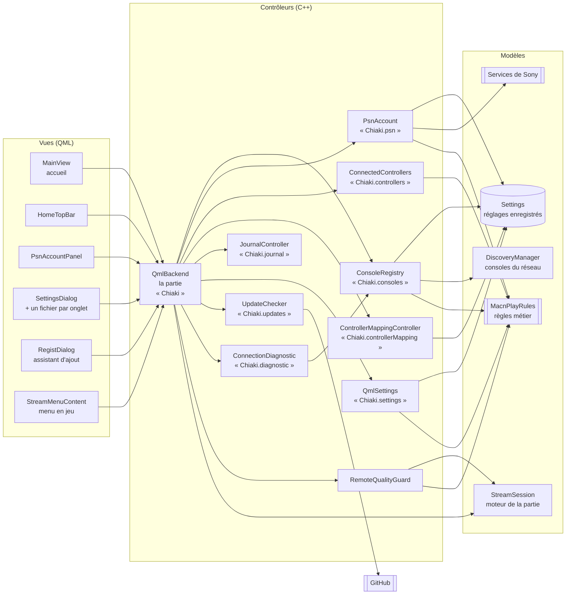

# Architecture de Mac'n'Play

Ce document explique comment le code de Mac'n'Play est organisé, pour qu'on puisse
s'y retrouver vite et trouver d'où vient une panne.

## Vue d'ensemble : le modèle MVC

L'interface de Mac'n'Play suit le modèle **Modèle – Vue – Contrôleur** :

- les **vues** (fichiers `.qml`) affichent et transmettent les actions de l'utilisateur ;
- les **contrôleurs** (classes C++) appliquent les règles et pilotent le reste ;
- les **modèles** gardent les données (réglages enregistrés, consoles, compte PSN) ou en sont la source (réseau).

Chaque contrôleur a **une seule responsabilité**.



Les écrans n'appellent jamais directement un modèle : ils passent toujours par `Chiaki`
(le contrôleur de la partie) ou par l'un des contrôleurs qu'il expose.

## Qui fait quoi

### Contrôleurs (`gui/include`, `gui/src`)

| Classe | Nom côté QML | Responsabilité unique |
|---|---|---|
| `QmlBackend` | `Chiaki` | Lancer, suivre et arrêter une partie ; réunir les autres contrôleurs pour les écrans |
| `ConsoleRegistry` | `Chiaki.consoles` | Les consoles : découverte, liste, association, réveil, masquage, limite de 2 |
| `PsnAccount` | `Chiaki.psn` | Le compte PSN : connexion, jetons, profil |
| `ConnectedControllers` | `Chiaki.controllers` | Les manettes branchées et la combinaison du menu en jeu |
| `ControllerMappingController` | `Chiaki.controllerMapping` | L'attribution des boutons d'une manette |
| `JournalController` | `Chiaki.journal` | Copier le journal, ouvrir son dossier |
| `UpdateChecker` | `Chiaki.updates` | Savoir si une version plus récente est publiée sur GitHub |
| `ConnectionDiagnostic` | `Chiaki.diagnostic` | « Tester ma connexion » : réseau, Internet, compte PSN, console |
| `RemoteQualityGuard` | (interne) | Qualité des parties par Internet : départ adapté, baisse si l'image perd des morceaux |
| `SingleInstance` | (interne) | Une seule copie de l'appli à la fois |
| `QmlSettings` | `Chiaki.settings` | Lire et modifier les réglages, réglages par console |

### Modèles

| Classe | Rôle |
|---|---|
| `Settings` | Réglages enregistrés (préférences macOS `com.macnplay.MacnPlay`) |
| `DiscoveryManager` | Consoles qui répondent sur le réseau local |
| `StreamSession` | Moteur de la partie : réseau, vidéo, son, manette (hérité de chiaki-ng) |
| `MacnPlayRules` | Règles métier en fonctions pures, testées automatiquement |

### Vues (`gui/src/qml`)

| Fichier | Écran |
|---|---|
| `Main.qml` | Fenêtre principale : enchaînement des écrans, boîtes de dialogue |
| `MainView.qml` | Accueil : cartes des consoles |
| `HomeTopBar.qml` | Barre du haut de l'accueil |
| `PsnAccountPanel.qml` | Panneau du compte PSN sur la carte |
| `SettingsDialog.qml` | Cadre des Paramètres (onglets, navigation) |
| `Settings…Tab.qml` | Un fichier par onglet des Paramètres |
| `SettingCard.qml`, `SettingSection.qml` | Carte d'un réglage, titre de section |
| `EssentialSettings.qml` | Page « L'essentiel » des Paramètres |
| `RegistDialog.qml` | Assistant d'ajout de console |
| `StreamView.qml`, `StreamMenuContent.qml` | Partie en cours et menu en jeu |

## Exemple : appuyer sur ✕ pour jouer

1. **Vue** : `MainView.qml` reçoit l'appui sur ✕ et appelle `Chiaki.connectToHost(clé, nom)`, où la clé identifie la console (« mac:… », « psn:… ») quel que soit son rang dans la liste.
2. **Contrôleur de la partie** : `QmlBackend::connectToHost` demande la console à `ConsoleRegistry::consoleByKey(clé)`.
   - Si elle n'est pas associée, il ouvre l'assistant (`registDialogRequested`).
   - Si elle est en veille, il la réveille avec `ConsoleRegistry::sendWakeup`.
3. **Modèle** : `QmlSettings::activateConsole` charge les réglages propres à cette console, puis `StreamSession` démarre la partie.
4. **Vue** : `Main.qml` reçoit `sessionChanged` et affiche `StreamView.qml`.

Chaque étape écrit une ligne dans le journal, par exemple :

```
14:25:49.102  info       [macnplay.session]  Lancement d'une partie sur "PS4-955" (réseau local)
```

## Localiser une panne : le journal

Chaque lancement de l'appli crée un fichier dans
`~/Library/Application Support/MacnPlay/MacnPlay/log/macnplay_<date>.log` (les 5 derniers sont gardés).
Les parties ont aussi leur propre journal (`chiaki_session_<date>.log`, plus détaillé).

Chaque ligne indique l'**heure**, la **gravité** et le **domaine** :

| Domaine | Ce qu'il couvre | Où chercher dans le code |
|---|---|---|
| `macnplay.psn` | Connexion PSN, jetons, profil | `PsnAccount` |
| `macnplay.consoles` | Découverte, association, réveil, consoles du compte | `ConsoleRegistry`, `DiscoveryManager` |
| `macnplay.session` | Lancement, fin de partie, qualité, veille | `QmlBackend` |
| `macnplay.controller` | Manettes branchées, attribution des boutons | `ConnectedControllers`, `ControllerMappingController` |

Dans l'appli : **Paramètres › Configuration › Copier le journal**, à coller dans un
[signalement](https://github.com/Fr0gzilla/Mac-n-Play/issues/new?template=probleme.md).

## Tests automatiques

Les règles métier sont dans `gui/include/macnplayrules.h` et vérifiées par `gui/tests/rulestest.cpp` :

- 2 consoles au maximum ;
- masque d'une combinaison de boutons (l'ordre ne compte pas) ;
- refus d'une combinaison « pavé tactile » identique à celle du menu en jeu ;
- renouvellement des jetons PSN une minute avant leur expiration ;
- comparaison des numéros de version (1.0.10 est plus récent que 1.0.9) ;
- reconnaissance d'un partage de connexion de téléphone ;
- qualité de départ d'une partie par Internet, et baisse quand les pertes durent ;
- nom affiché de la PS4 du compte (« PS4-955 » plutôt que « Main PS4 Console »).

Ils tournent à chaque fabrication sur GitHub. En local :

```sh
cmake --build build --target macnplay-rules-test && ctest --test-dir build -R macnplay-rules
```

## Ce qui vient de chiaki-ng

Le moteur réseau (`lib/`, en C : protocole Remote Play de Sony) et le rendu vidéo
(`gui/src/qmlmainwindow.cpp`) viennent de [chiaki-ng](https://github.com/streetpea/chiaki-ng)
et sont gardés tels quels. Ils sont très techniques, et les modifier sans tests risquerait
de casser l'image ou la connexion. La réorganisation MVC concerne la couche Mac'n'Play :
l'interface et ses contrôleurs.

Ce qui ne servait pas sur Mac a été retiré du dépôt : versions Windows, Linux (Flatpak, AppImage),
Steam Deck, Nintendo Switch, artwork Steam et documentation de chiaki-ng. On les retrouve dans
[chiaki-ng](https://github.com/streetpea/chiaki-ng) ou dans l'historique Git de ce dépôt.

## Règles pour écrire du code dans ce projet

- **Une classe, un rôle** : si une classe doit faire autre chose, on crée un nouveau contrôleur.
- **Pas de règle métier dans le QML** : une vue affiche et transmet. Une règle va dans un contrôleur, et si possible dans `MacnPlayRules`, avec un test.
- **Chaque fichier commence par un commentaire** qui dit son rôle.
- **Les noms disent ce que fait le code** (`consoleByKey`, `markWaking`, `forgetCredentials`). Les commentaires expliquent *pourquoi*, pas *quoi*.
- **Journaliser les étapes importantes** avec la catégorie du domaine (`qCInfo(logConsoles) << …`), en français.
