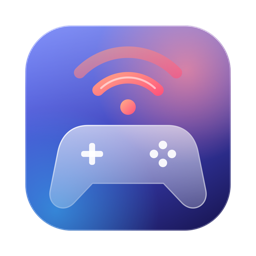

<p align="center">
  
</p>

<h1 align="center">Mac'n'Play</h1>

<p align="center">
  Jouez à votre PS4 ou PS5 sur votre Mac, avec votre manette.<br>
  <a href="#english">English version below</a>
</p>

<p align="center">
  <a href="https://github.com/Fr0gzilla/Mac-n-Play/releases/latest"><b>⬇ Télécharger la dernière version</b></a>
</p>

---

## Ce que fait l'appli

Mac'n'Play affiche l'écran de votre PlayStation sur votre Mac (Remote Play) et transmet votre manette à la console. C'est une version pensée pour macOS, basée sur le projet libre [chiaki-ng](https://github.com/streetpea/chiaki-ng).

- **Accueil à la manette** : la carte de votre console, son état (allumée, en veille), et un appui sur ✕ pour jouer.
- **Votre compte PSN** sur l'accueil : avatar, pseudo, niveau et trophées.
- **Réglages automatiques** adaptés à votre console et à votre connexion, modifiables à tout moment.
- **Menu en jeu** (L1 + R1 + L3 + R3) : volume, micro, zoom, qualité d'image, retour à l'accueil.
- **Baisse de qualité en pleine partie** si votre connexion a du mal, sans réduire la taille de l'image.
- **Jusqu'à deux consoles**, chacune avec ses propres réglages.
- **Assistant d'ajout de console** en trois étapes, avec les explications à chaque écran.
- Entièrement en français.

## Ce qu'il faut

- Un **Mac avec puce Apple** (M1, M2, M3, M4 ou M5) sous **macOS 15 Sequoia ou plus récent**.
- Une **PS4 ou PS5** avec la lecture à distance activée.
- Un **compte PlayStation Network** (celui utilisé sur la console).
- Une **manette** : DualShock 4 (PS4) ou DualSense (PS5), en Bluetooth ou par câble.
- Pour un bon résultat, le Mac et la console sur le **même réseau**, de préférence la console branchée en câble.

> Les Mac Intel ne sont pas pris en charge.

## Installation

1. Téléchargez le fichier `Mac-n-Play-….dmg` depuis la [page des versions](https://github.com/Fr0gzilla/Mac-n-Play/releases/latest).
2. Ouvrez-le, puis glissez **Mac'n'Play** dans le dossier **Applications**.
3. Lancez l'appli depuis Applications.

### Ou avec Homebrew

Si vous utilisez [Homebrew](https://brew.sh) :

```sh
brew tap fr0gzilla/macnplay https://github.com/Fr0gzilla/Mac-n-Play
brew install --cask macnplay
```

Mises à jour : `brew upgrade --cask macnplay`.

### « Apple n'a pas pu vérifier… » : c'est normal

L'appli est gratuite et n'est pas enregistrée auprès d'Apple (ce qui coûte 99 € par an). Au premier lancement, macOS la bloque. Pour l'autoriser, une seule fois :

1. Essayez d'ouvrir Mac'n'Play, puis cliquez sur **OK** dans le message.
2. Ouvrez **Réglages Système** › **Confidentialité et sécurité**.
3. Tout en bas, à côté de « Mac'n'Play a été bloquée », cliquez sur **Ouvrir quand même**, puis confirmez avec votre mot de passe.

<details>
<summary>Autre méthode, avec le Terminal</summary>

Collez cette ligne dans l'appli Terminal, puis appuyez sur Entrée :

```sh
xattr -dr com.apple.quarantine "/Applications/Mac'n'Play.app"
```
</details>

## Premiers pas

1. **Préparez la console**
   - PS4 : Paramètres › Paramètres de connexion de la lecture à distance › cochez *Activer la lecture à distance*.
   - PS5 : Paramètres › Système › Lecture à distance › activez *Activer la lecture à distance*.
2. **Connectez votre compte PSN** dans l'appli (Paramètres › À distance › Compte PSN) : une page de connexion PlayStation s'ouvre.
3. **Ajoutez la console** avec le bouton **+** en haut de l'accueil (ou R3 à la manette). L'assistant vous demande un code à 8 chiffres : il s'affiche sur la console, dans *Ajouter un appareil* (même menu que l'étape 1).
4. **Appuyez sur ✕** sur la carte de la console pour jouer. Si elle est en veille, l'appli la réveille.

## Raccourcis de la manette

| Combinaison | Effet |
|---|---|
| L1 + R1 + L3 + R3 | Ouvrir ou fermer le menu en jeu |
| L1 + R1 + Haut (maintenir) | La croix directionnelle sert de pavé tactile, pour les jeux qui en ont besoin |
| Options (dans les Paramètres) | Fermer les Paramètres |
| R1 (accueil) | Actualiser les consoles du compte PSN |
| R3 (accueil) | Ajouter une console |

Toutes ces combinaisons se modifient dans Paramètres › Manettes.

## En cas de problème

- **La console n'apparaît pas** : vérifiez que le Mac et la console sont sur le même réseau, et que la lecture à distance est activée sur la console.
- **« La console est déjà utilisée »** : une autre lecture à distance est ouverte (sur un téléphone, un autre ordinateur, ou une autre fenêtre de Mac'n'Play). Fermez-la et réessayez.
- **L'image saccade** : ouvrez le menu en jeu (L1 + R1 + L3 + R3) et baissez la **qualité**. Brancher la console en câble aide beaucoup.
- **La manette ne répond pas** : déconnectez-la puis reconnectez-la dans Réglages Système › Bluetooth.

Pour signaler un problème : [ouvrir un ticket](https://github.com/Fr0gzilla/Mac-n-Play/issues), en précisant votre modèle de Mac, votre version de macOS et votre console.

## État du projet

Mac'n'Play est testé sur **PS4 en réseau local** avec une manette DualShock 4. La **PS5** et le **jeu hors de chez soi** (par Internet) sont présents mais n'ont pas encore été testés : vos retours sont les bienvenus.

## Fabriquer l'appli soi-même

Les étapes complètes sont dans [`.github/workflows/build-macos-arm.yml`](.github/workflows/build-macos-arm.yml) : elles s'appuient sur [Homebrew](https://brew.sh), Qt 6 et CMake.

## Licence et crédits

- Mac'n'Play est un logiciel libre, distribué sous licence **[GNU AGPL v3](COPYING)** (avec l'exception OpenSSL, voir [`LICENSES`](LICENSES)). Son code source complet est dans ce dépôt.
- Il est basé sur **[chiaki-ng](https://github.com/streetpea/chiaki-ng)** de Street Pea et ses contributeurs, lui-même dérivé de **[Chiaki](https://git.sr.ht/~thestr4ng3r/chiaki)** de Florian Märkl. Merci à eux.
- Mac'n'Play n'est ni approuvé ni certifié par Sony Interactive Entertainment. « PlayStation », « PS4 », « PS5 », « DualShock » et « DualSense » sont des marques de Sony Interactive Entertainment Inc.

---

<a id="english"></a>

## English

**Mac'n'Play** lets you play your PS4 or PS5 on your Mac with your controller (Remote Play). It is a macOS-focused version of the open source [chiaki-ng](https://github.com/streetpea/chiaki-ng) project. The interface is in French; English text appears where no translation exists.

### Requirements

- A Mac with **Apple silicon** (M1 to M5) running **macOS 15 Sequoia or later**. Intel Macs are not supported.
- A PS4 or PS5 with Remote Play enabled, a PlayStation Network account, and a DualShock 4 or DualSense controller.

### Install

1. Download `Mac-n-Play-….dmg` from the [releases page](https://github.com/Fr0gzilla/Mac-n-Play/releases/latest), open it and drag **Mac'n'Play** to **Applications**.
   With Homebrew: `brew tap fr0gzilla/macnplay https://github.com/Fr0gzilla/Mac-n-Play && brew install --cask macnplay`
2. The app is not notarized by Apple, so macOS blocks the first launch. Try to open it, click **OK**, then go to **System Settings › Privacy & Security** and click **Open Anyway**. Or run:
   ```sh
   xattr -dr com.apple.quarantine "/Applications/Mac'n'Play.app"
   ```

### Getting started

1. Enable Remote Play on the console.
2. Sign in to PSN in the app (Paramètres › À distance).
3. Add your console with the **+** button (or R3) and enter the 8-digit code shown on the console under *Add Device*.
4. Press ✕ on the console card to play. **L1 + R1 + L3 + R3** opens the in-game menu (volume, zoom, quality, back to home).

### Status

Tested on **PS4 over a local network**. PS5 and playing over the Internet are included but not tested yet; feedback is welcome in the [issues](https://github.com/Fr0gzilla/Mac-n-Play/issues).

### License

Free software under the **[GNU AGPL v3](COPYING)** (with OpenSSL exception). Based on [chiaki-ng](https://github.com/streetpea/chiaki-ng) by Street Pea and contributors, derived from [Chiaki](https://git.sr.ht/~thestr4ng3r/chiaki) by Florian Märkl. Not endorsed or certified by Sony Interactive Entertainment. "PlayStation", "PS4", "PS5", "DualShock" and "DualSense" are trademarks of Sony Interactive Entertainment Inc.
